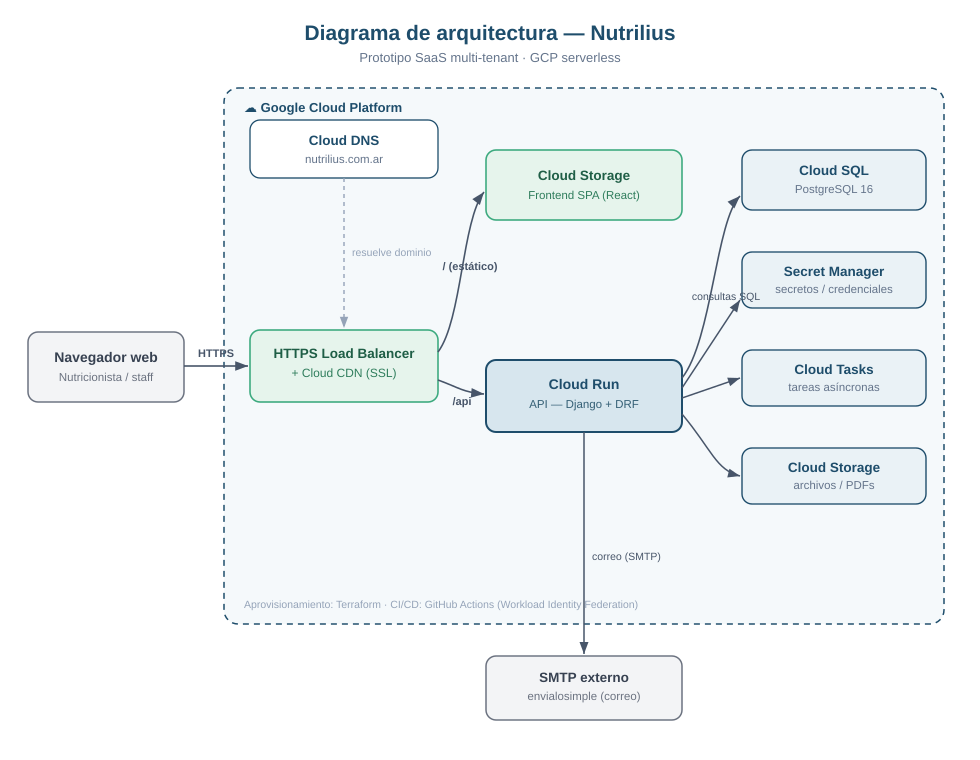

# Diagrama de arquitectura — Nutrilius (Entrega 2)

> Cubre el entregable **"Diagrama de arquitectura"** del camino Scrum de la Entrega 2
> (la consigna pide el diagrama **+ un breve relato** de su funcionamiento).
> Diagrama: `docs/arquitectura.svg` (vectorial) y `capturas-entrega2/10-arquitectura.png`.

## Relato de funcionamiento

En el diagrama se visualiza la arquitectura del prototipo, un **SaaS multi-tenant
serverless** desplegado sobre **Google Cloud Platform**. El profesional (nutricionista
o staff) accede desde su **navegador web** a `nutrilius.com.ar`. **Cloud DNS** resuelve
el dominio hacia el **HTTPS Load Balancer**, que —junto con **Cloud CDN**— termina el
TLS y enruta el tráfico según la ruta solicitada: la raíz `/` entrega el **frontend
estático** (una SPA de React alojada en un bucket de **Cloud Storage**), mientras que
`/api` se dirige a **Cloud Run**, donde se ejecuta la **API (Django + DRF)**.

**Cloud Run** es el núcleo de la aplicación y concentra la lógica de negocio: consulta
la base de datos relacional **Cloud SQL (PostgreSQL 16)**, obtiene sus credenciales de
**Secret Manager**, encola trabajos en segundo plano en **Cloud Tasks**, almacena
archivos y PDFs en **Cloud Storage**, y envía los correos transaccionales
(confirmaciones, recuperación de contraseña) a través de un **servidor SMTP externo**
(envialosimple). Al ser una arquitectura **serverless**, los componentes de cómputo
**escalan a demanda** (incluso a cero), sin servidores que administrar.

Toda la infraestructura se **aprovisiona con Terraform** (infraestructura como código) y
se **despliega mediante GitHub Actions** usando **Workload Identity Federation** (sin
claves de larga vida), garantizando un pipeline reproducible y seguro.

## Componentes

| Componente | Servicio GCP | Rol |
|---|---|---|
| DNS | Cloud DNS | Resuelve `nutrilius.com.ar` |
| Borde / TLS / caché | HTTPS Load Balancer + Cloud CDN | Enrutamiento `/` y `/api`, SSL, caché del frontend |
| Frontend | Cloud Storage (bucket) | SPA React estática |
| API / backend | Cloud Run | Django + DRF (lógica de negocio, multi-tenant) |
| Base de datos | Cloud SQL | PostgreSQL 16 |
| Secretos | Secret Manager | Credenciales fuera del repo |
| Tareas async | Cloud Tasks | Trabajos en segundo plano |
| Archivos | Cloud Storage (bucket) | Logos, PDFs, media |
| Correo | SMTP externo (envialosimple) | Emails transaccionales |
| IaC / CI-CD | Terraform + GitHub Actions (WIF) | Aprovisionamiento y despliegue |

> Nota: el detalle ampliado de infraestructura está en `INFRAESTRUCTURA.md` y las
> decisiones en `DECISIONES_TECNICAS_Y_SEGURIDAD.md` (DT-11, DS-07, DS-10).
