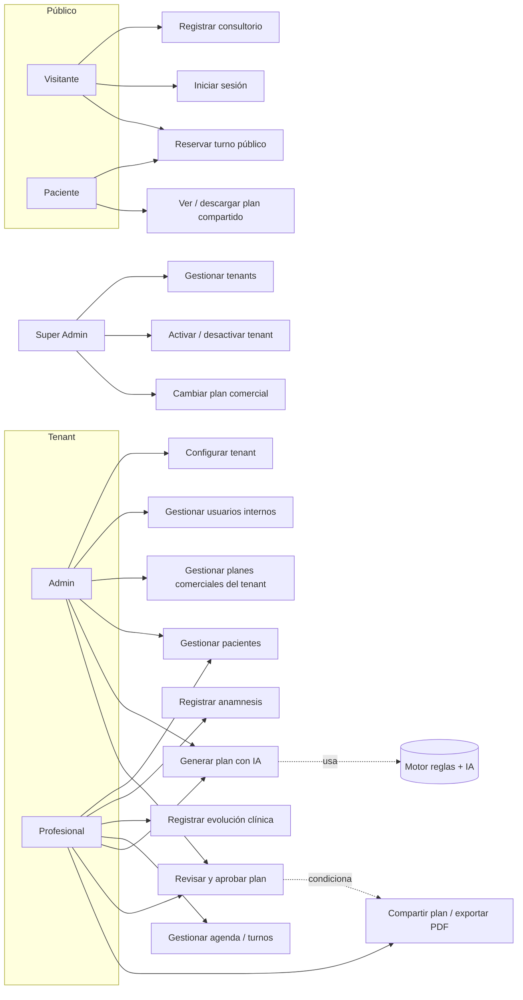
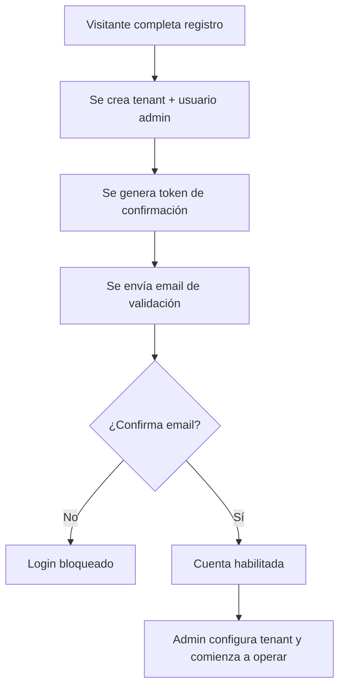
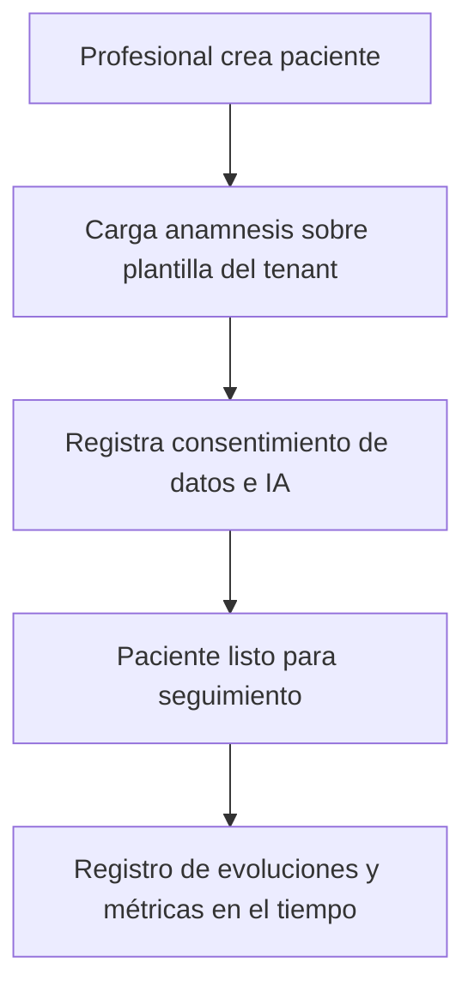
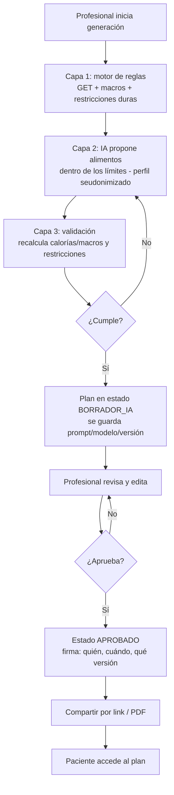
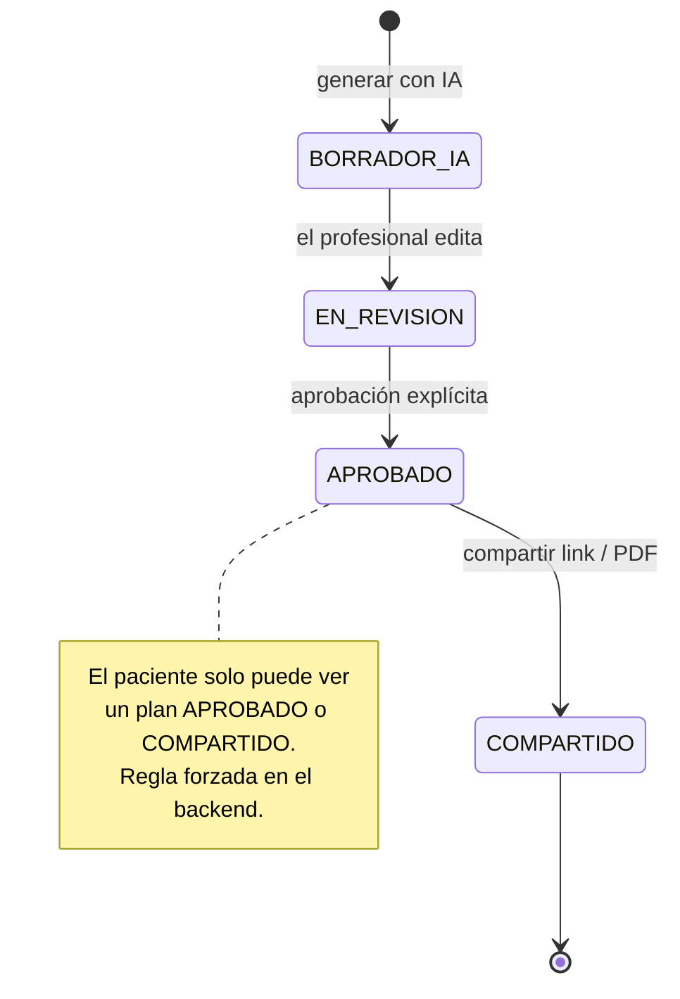
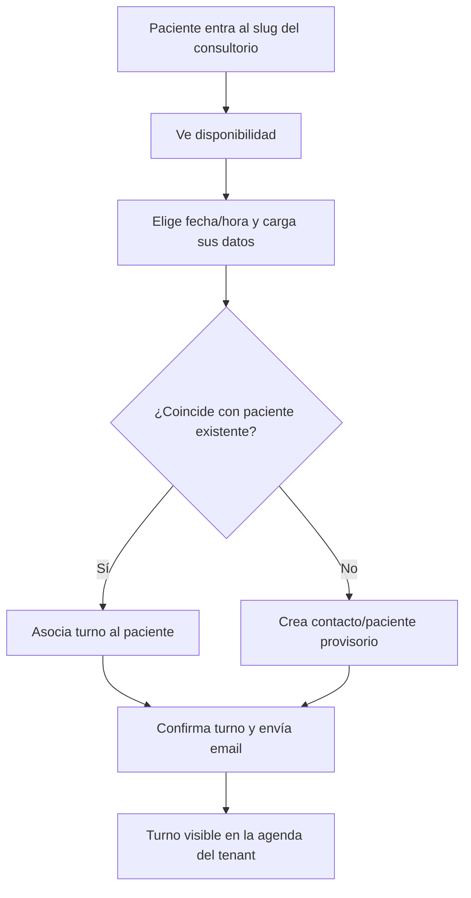
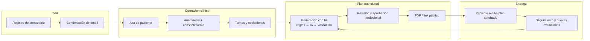

# Casos de uso y flujos de negocio — Nutrilius

Documento funcional. Describe los actores, los casos de uso por módulo y los
flujos de negocio del sistema, incluido el proceso integrador de punta a punta.
Sirve de insumo para la Primera entrega (relevamiento funcional + proceso de
negocio) y para el diseño del backend en Django.

Stack de reconstrucción: `Python + Django + Django REST Framework` (ver
`PROJECT_TECHNICAL_SPEC.md` §12.1). Los casos de uso son independientes del
stack; los flujos aplican igual sobre la implementación en Django.

---

## 1. Actores

| Actor | Descripción | Ámbito |
|---|---|---|
| **Super Admin** | Administra la plataforma de forma transversal (tenants, planes comerciales). | Fuera del tenant |
| **Admin (nutricionista titular)** | Dueño del consultorio. Configura el tenant, gestiona usuarios internos y opera clínicamente. | Su tenant |
| **Usuario / profesional (staff)** | Nutricionista o asistente que opera sobre pacientes del tenant. | Su tenant |
| **Paciente** | Recibe planes (link/PDF) y puede reservar turnos desde el portal público. No opera el sistema. | Externo |
| **Visitante público** | Aún no registrado: landing, registro de tenant, login, reserva por link público. | Externo |
| **Sistema — Motor de reglas + IA** | Actor de apoyo. Calcula parámetros nutricionales, propone el plan (LLM) y valida la salida. **Nunca decide solo.** | Interno |

---

## 2. Mapa de casos de uso

---

## 3. Casos de uso por módulo

### 3.1 Onboarding e identidad
- **CU-01 Registrar consultorio (tenant):** el visitante crea un tenant + usuario admin; recibe email de confirmación.
- **CU-02 Confirmar email:** valida la propiedad del correo antes de habilitar el login.
- **CU-03 Iniciar sesión:** login con email/contraseña, JWT + refresh. Bloqueo si el email no fue confirmado.
- **CU-04 Recuperar contraseña:** solicitud por email, token temporal, reset.
- **CU-05 Gestionar usuarios internos:** invitar, listar, desactivar usuarios del tenant.

### 3.2 Pacientes y registro clínico
- **CU-06 Gestionar pacientes:** alta, edición, búsqueda paginada, desactivar/reactivar.
- **CU-07 Registrar anamnesis:** carga inicial y edición, sobre plantilla configurable por tenant. Consulta histórica.
- **CU-08 Registrar evolución clínica:** CRUD de evoluciones.
- **CU-09 Registrar métricas antropométricas:** peso, pliegues, IMC, etc. *(pendiente)*.

### 3.3 Agenda
- **CU-10 Gestionar turnos:** crear/editar/cancelar; vista por día/semana.
- **CU-11 Reservar turno público:** el paciente reserva desde el slug del consultorio, sin login; confirmación por email.

### 3.4 Planes nutricionales con IA *(módulo diferencial)*
- **CU-12 Generar plan con IA:** ver detalle en 3.5.
- **CU-13 Revisar y aprobar plan:** el profesional edita y aprueba; gate obligatorio previo a la entrega.
- **CU-14 Compartir plan / exportar PDF:** solo sobre plan aprobado; link público revocable con branding del tenant.
- **CU-15 Gestionar plantillas de plan:** crear/editar/borrar estructuras reutilizables.

### 3.5 Administración de plataforma (Super Admin)
- **CU-16 Gestionar tenants:** listar, activar/desactivar.
- **CU-17 Cambiar plan comercial / feature flags del tenant.**

---

## 4. Caso de uso detallado — CU-12 Generar plan con IA (supervisada)

**Actor principal:** Profesional / Admin
**Actor de apoyo:** Motor de reglas + IA
**Precondiciones:** paciente con anamnesis cargada; tenant con módulo de planes habilitado (`PRO`/`PREMIUM`); consentimiento del paciente para uso de IA registrado.

**Flujo principal:**
1. El profesional selecciona un paciente e inicia "Generar plan".
2. **Capa 1 — Motor de reglas (determinística):** el sistema calcula el requerimiento energético (p. ej. Mifflin-St Jeor), la distribución de macronutrientes según objetivo, y arma las **restricciones duras** (alergias, intolerancias, patologías).
3. **Capa 2 — IA (LLM):** el sistema envía al modelo un perfil **seudonimizado** (sin datos identificatorios) + los parámetros y restricciones de la Capa 1. El LLM propone alimentos y variedad **dentro** de esos límites, localizado a Argentina.
4. **Capa 3 — Validación (determinística):** el sistema recalcula calorías/macros del plan generado y verifica que respete rangos y restricciones. Si se sale → regenera o marca para revisión.
5. El plan queda en estado **BORRADOR_IA**. Se registra prompt, modelo, versión, timestamp y usuario (trazabilidad).
6. El profesional pasa a CU-13 (revisar y aprobar).

**Flujos alternativos:**
- *2a.* Faltan datos para el cálculo → el sistema pide completar anamnesis; no se llama al LLM.
- *4a.* El plan viola una restricción dura → se descarta y se regenera automáticamente (máx. N intentos), o se marca para ajuste manual.
- *3a.* Falla el proveedor de IA → fallback de modelo/proveedor; si persiste, se ofrece armado manual desde plantilla.

**Postcondiciones:** existe un plan en estado `BORRADOR_IA`, nunca visible para el paciente hasta ser aprobado.

---

## 5. Flujos de negocio

### 5.1 Onboarding de consultorio

### 5.2 Alta de paciente y anamnesis

### 5.3 Generación de plan con IA supervisada *(flujo central)*

**Máquina de estados del plan (restricción de diseño):**

### 5.4 Reserva de turno desde el portal público

---

## 6. Proceso de negocio integrador (end-to-end)

Integra los procesos funcionales relevados en un único recorrido del negocio:
desde que un consultorio se da de alta hasta que el paciente recibe un plan
validado por el profesional.

**Hitos de control (restricciones de diseño explícitas):**
1. Sin email confirmado, no hay operación (`Alta`).
2. Sin anamnesis y consentimiento, no se genera plan con IA (`Operación → Plan`).
3. La IA opera acotada por el motor de reglas y su salida se valida (`Plan`).
4. Ningún plan llega al paciente sin **aprobación profesional** registrada (`Plan → Entrega`).
5. Todo acceso a datos clínicos sensibles queda auditado (transversal).
