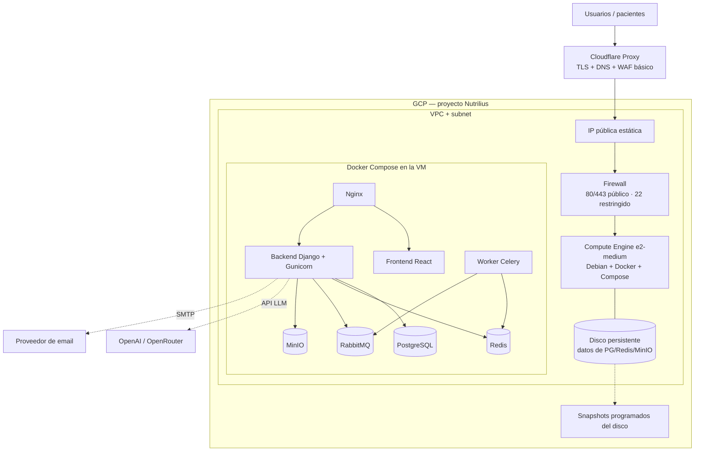

# Infraestructura — Nutrilius

Documento de infraestructura y despliegue. Describe cómo se aloja y opera
Nutrilius en **Google Cloud Platform (GCP)** usando **Compute Engine** como
servidor único, aprovisionado con **Terraform** y operado con **Docker Compose**.

Alineado con el lineamiento del `PROJECT_TECHNICAL_SPEC.md` §13.5: desplegable en
contenedores, sobre un servidor propio/económico, sin depender obligatoriamente de
servicios cloud administrados.

---

## 1. Enfoque

| Decisión | Elección | Motivo |
|---|---|---|
| Nube | **GCP** | Requisito del proyecto |
| Cómputo | **Compute Engine (1 VM)** | Simple, barato y predecible; reusa el `docker-compose.yml` tal cual |
| Provisioning | **Terraform** | Infraestructura como código, versionada y reproducible |
| Orquestación | **Docker Compose** | Un solo host; sin complejidad de Kubernetes |
| TLS / borde | **Cloudflare Proxy** | TLS gestionado, oculta la IP de origen, absorbe tráfico básico |
| Región | `southamerica-east1` (São Paulo) | La más cercana a Argentina (menor latencia) |

**Por qué una sola VM y no Cloud Run + servicios administrados:** para un prototipo
de tesis, Compute Engine da control total y costo bajo/predecible. Los servicios
administrados (Cloud SQL, Memorystore) suman costo fijo mensual corran o no, y
Celery encaja mal en Cloud Run. La evolución a servicios administrados queda
planteada en §9, no como requisito inicial.

---

## 2. Arquitectura



---

## 3. Recursos de GCP (gestionados por Terraform)

| Recurso | Terraform | Descripción |
|---|---|---|
| VPC + subnet | `google_compute_network`, `google_compute_subnetwork` | Red aislada del proyecto |
| Firewall | `google_compute_firewall` | Permite 80/443 desde internet; 22 (SSH) solo desde IP admin |
| IP estática | `google_compute_address` | IP pública fija para apuntar el DNS/Cloudflare |
| Instancia | `google_compute_instance` | VM `e2-medium` (2 vCPU / 4 GB), Debian 12, Docker preinstalado |
| Disco de datos | `google_compute_disk` + attach | Disco persistente aparte para los volúmenes de datos |
| Service account | `google_service_account` | Identidad de la VM con permisos mínimos |
| Snapshots | `google_compute_resource_policy` | Política de backup automático del disco |
| Estado remoto | bucket `google_storage_bucket` | Backend de Terraform (state versionado y bloqueado) |

> **Datos que NO van en Terraform:** contraseñas, `JWT_SECRET`, `AI_API_KEY`,
> credenciales SMTP. Viven en el archivo `.env` **dentro de la VM** (o en Secret
> Manager en una etapa posterior), nunca en el código ni en el state.

---

## 4. Estructura de Terraform

```
infra/terraform/
  versions.tf     # provider google, versión de Terraform, backend GCS del state
  variables.tf    # project_id, region, zone, machine_type, ssh_admin_cidr, ...
  network.tf      # VPC, subnet, reglas de firewall
  compute.tf      # instancia Compute Engine, disco de datos, IP estática, SA
  backups.tf      # política de snapshots del disco
  startup.sh      # cloud-init: instala Docker + Compose y prepara el host
  outputs.tf      # IP pública y comando SSH
  terraform.tfvars.example  # valores de ejemplo (sin secretos)
```

### Variables principales

| Variable | Ejemplo | Descripción |
|---|---|---|
| `project_id` | `nutrilius-prod` | ID del proyecto de GCP |
| `region` | `southamerica-east1` | Región |
| `zone` | `southamerica-east1-b` | Zona de la VM |
| `machine_type` | `e2-medium` | Tipo de máquina (mínimo cómodo para el stack completo) |
| `data_disk_gb` | `30` | Tamaño del disco de datos |
| `ssh_admin_cidr` | `<tu-ip>/32` | IP autorizada para SSH |
| `image_family` | `debian-12` | Imagen base |

---

## 5. Flujo de despliegue

**Requisitos previos (una vez):**
1. Proyecto de GCP con **billing habilitado**.
2. `gcloud` autenticado:

```bash
gcloud auth application-default login
```

3. APIs habilitadas: Compute Engine, Cloud Storage.
4. Bucket para el state de Terraform (o crearlo con Terraform en un bootstrap).

**Aprovisionar la infraestructura:**

```bash
cd infra/terraform
terraform init
terraform plan -out plan.tfplan
terraform apply plan.tfplan
```

**Desplegar la aplicación (dentro de la VM):**
1. Conectarse por SSH (el `outputs.tf` imprime el comando).
2. Clonar el repositorio.
3. Crear el archivo `.env` con los valores reales de producción.
4. Levantar el stack:

```bash
docker compose up -d --build
```

El `startup.sh` deja Docker y Docker Compose ya instalados, así que el primer
`up` es lo único manual. Automatizar este paso (CI/CD con GitHub Actions) queda
como mejora futura.

---

## 6. Seguridad

- **Firewall:** 80/443 abiertos; SSH (22) restringido a la IP del administrador (`ssh_admin_cidr`).
- **TLS:** terminado en Cloudflare (o Let's Encrypt vía Nginx si no se usa Cloudflare).
- **Origen oculto:** Cloudflare Proxy delante del dominio evita exponer la IP directa.
- **Secretos:** fuera del repo y del state; en `.env` de la VM o Secret Manager.
- **Service account:** con el mínimo de permisos necesarios.
- **Datos sensibles de salud:** el disco persistente puede cifrarse con CMEK;
  backups por snapshot; acceso auditado a nivel aplicación (ver spec §13.2).
- **Actualizaciones:** parcheo del SO y de imágenes de contenedor de forma periódica.

---

## 7. Backups y recuperación

- **Snapshots automáticos** del disco de datos (política diaria, retención configurable).
- **Dump lógico de PostgreSQL** (`pg_dump`) programado como tarea, subido a Cloud Storage.
- Recuperación: recrear la VM con Terraform y re-adjuntar el disco / restaurar snapshot.

---

## 8. Costos estimados (orden de magnitud)

| Ítem | Estimado mensual (USD) |
|---|---|
| Compute Engine `e2-medium` (on-demand) | ~25–30 |
| Disco persistente 30 GB | ~1.5 |
| IP estática | ~3 (si la VM está encendida, suele ser gratis) |
| Egress / tráfico | bajo para prototipo |
| Cloudflare | Free tier |
| **Total aproximado** | **~30–35** |

Con `e2-micro` (free tier) el costo baja, pero 1 GB de RAM es insuficiente para
todo el stack junto. `e2-medium` es el mínimo cómodo.

---

## 9. Evolución futura (no requerido en el prototipo)

- **PostgreSQL → Cloud SQL** (backups y alta disponibilidad administrados).
- **MinIO → Cloud Storage (GCS)** vía `django-storages`.
- **Redis → Memorystore.**
- **VM única → Cloud Run** para la API y el front, dejando datos en servicios administrados.
- **CI/CD:** build y push de imágenes + deploy automático desde GitHub Actions.
- **Observabilidad:** Cloud Logging / Monitoring por servicio.
