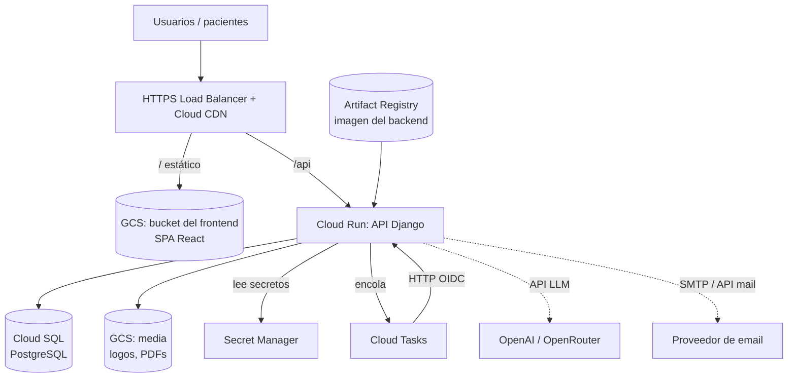

# Infraestructura — Nutrilius

Documento de infraestructura y despliegue. Nutrilius se despliega **serverless en
Google Cloud Platform (GCP)**, aprovisionado con **Terraform**: API en **Cloud Run**,
base en **Cloud SQL**, frontend estático en **Cloud Storage detrás de un HTTPS Load
Balancer con Cloud CDN**, tareas async con **Cloud Tasks**, archivos en **Cloud
Storage** y secretos en **Secret Manager**.

Reemplaza el enfoque previo de VM única (Compute Engine): se prioriza escalar a
cero, no administrar servidores y mantener los secretos fuera del código.

---

## 1. Enfoque

| Decisión | Elección | Motivo |
|---|---|---|
| Nube | **GCP** | Requisito del proyecto |
| API | **Cloud Run** (contenedor) | Serverless, escala a cero, reusa el Dockerfile |
| Base de datos | **Cloud SQL (PostgreSQL)** | Estado gestionado; Cloud Run es stateless |
| Frontend | **GCS + HTTPS LB + Cloud CDN** | SPA estático servido por la CDN de Google (equivalente a CloudFront) |
| Tareas async | **Cloud Tasks → Cloud Run** | Serverless; sin Redis/RabbitMQ ni worker siempre encendido |
| Archivos | **Cloud Storage (GCS)** | Logos y PDFs; reemplaza MinIO |
| Secretos | **Secret Manager** | Inyectados en Cloud Run; nunca en repo/código/state |
| IaC | **Terraform** | Infra reproducible y versionada |
| Región | `southamerica-east1` (São Paulo) | Cercanía a Argentina |

---

## 2. Arquitectura



Flujo: el Load Balancer sirve el SPA desde GCS por la CDN y enruta `/api/*` a Cloud
Run. La API usa Cloud SQL, guarda binarios en GCS, lee secretos de Secret Manager y
delega trabajo diferido (mails, PDFs, generación IA) encolando en Cloud Tasks, que
reingresa por HTTP autenticado a un endpoint interno de la misma API.

---

## 3. Componentes (gestionados por Terraform)

| Recurso | Terraform | Descripción |
|---|---|---|
| Artifact Registry | `google_artifact_registry_repository` | Registro de la imagen del backend |
| Cloud Run (API) | `google_cloud_run_v2_service` | Servicio Django; escala a cero; SA propia |
| Cloud SQL | `google_sql_database_instance` + `_database` + `_user` | PostgreSQL gestionado |
| Bucket frontend | `google_storage_bucket` | SPA estático (index + assets) |
| Bucket media | `google_storage_bucket` | Logos y PDFs (privados, URLs firmadas) |
| HTTPS LB + CDN | `google_compute_*` (backend bucket + backend service Cloud Run, URL map, cert) | Un dominio: `/` → bucket, `/api` → Cloud Run, con Cloud CDN |
| Cloud Tasks | `google_cloud_tasks_queue` | Cola de tareas diferidas |
| Secret Manager | `google_secret_manager_secret` (+ IAM) | Contenedores de secretos (sin valores en Terraform) |
| Service Accounts | `google_service_account` + IAM | Identidades mínimas para Cloud Run y Cloud Tasks |
| Estado remoto | bucket `google_storage_bucket` | Backend de Terraform (state versionado) |

> **Secretos:** Terraform crea los *contenedores* en Secret Manager, pero **los
> valores se cargan aparte** (CLI/consola), nunca en `.tf`, `tfvars` ni en el state.

---

## 4. Estructura de Terraform

```
infra/terraform/
  versions.tf     # provider google, backend GCS del state
  variables.tf    # project_id, region, dominio, tier de Cloud SQL, ...
  artifact.tf     # Artifact Registry
  run.tf          # Cloud Run (API) + SA + acceso a Secret Manager y Cloud SQL
  sql.tf          # Cloud SQL instance + database + user
  storage.tf      # buckets front y media
  loadbalancer.tf # HTTPS LB + Cloud CDN (URL map: / -> bucket, /api -> Run)
  tasks.tf        # Cloud Tasks queue + SA con OIDC hacia Cloud Run
  secrets.tf      # contenedores en Secret Manager + bindings IAM
  outputs.tf      # URL del LB, del servicio Run, nombre de instancia SQL
```

### Variables principales

| Variable | Ejemplo | Descripción |
|---|---|---|
| `project_id` | `nutrilius-prod` | Proyecto de GCP |
| `region` | `southamerica-east1` | Región |
| `domain` | `nutrilius.com.ar` | Dominio del LB / certificado |
| `image` | `...-docker.pkg.dev/.../backend:TAG` | Imagen del backend |
| `sql_tier` | `db-f1-micro` (o `db-g1-small`) | Tamaño de Cloud SQL |
| `run_min_instances` | `0` | Escala a cero |
| `run_max_instances` | `4` | Techo de escalado |

---

## 5. Flujo de despliegue

**Requisitos previos (una vez):** proyecto GCP con billing; `gcloud` autenticado
(`gcloud auth application-default login`); APIs habilitadas (Cloud Run, Cloud SQL,
Artifact Registry, Cloud Tasks, Secret Manager, Compute); bucket para el state.

**1) Cargar secretos** (una vez, fuera de Terraform):

```bash
printf '%s' "$DJANGO_SECRET_KEY" | gcloud secrets create django-secret-key --data-file=-
```

**2) Aprovisionar infra:**

```bash
cd infra/terraform && terraform init && terraform apply
```

**3) Build & deploy del backend** (imagen → Artifact Registry → Cloud Run):

```bash
gcloud builds submit backend --tag "$IMAGE" && gcloud run deploy nutrilius-api --image "$IMAGE"
```

**4) Deploy del frontend** (build del SPA → bucket → invalidar CDN):

```bash
cd frontend && npm run build && gcloud storage rsync -r dist "gs://$FRONT_BUCKET"
```

En Cloud Run, `DJANGO_SETTINGS_MODULE=config.settings.prod`, migraciones vía job de
release (`python manage.py migrate`), y los secretos se referencian desde Secret
Manager (`--set-secrets`).

---

## 6. Seguridad

- **Secretos en Secret Manager** (DS-07): DB, `DJANGO_SECRET_KEY`, API de IA, SMTP. Cloud Run los recibe como env/volúmenes; nunca en repo ni state.
- **Cloud SQL** sin IP pública (conector de Cloud Run) o con IP autorizada + Auth Proxy; contraseña en Secret Manager.
- **Buckets privados**: el de media no es público; se sirve con **URLs firmadas** y expiración (compartición de PDF revocable, RNF-05).
- **Cloud Tasks con OIDC**: el reingreso a la API va autenticado por service account; el endpoint interno rechaza llamadas sin token.
- **TLS gestionado** por el Load Balancer (certificado administrado por Google); CORS/CSP estrictos.
- **IAM de mínimo privilegio** por service account (Run, Tasks).
- **Datos de salud**: Cloud SQL cifra en reposo; acceso auditado a nivel app (RNF-02/03).

---

## 7. Costos estimados (orden de magnitud)

| Ítem | Estimado mensual (USD) |
|---|---|
| Cloud Run (escala a cero, tráfico bajo) | ~0–5 |
| Cloud SQL `db-f1-micro` | ~9–15 (costo fijo) |
| GCS + Cloud CDN (SPA + media) | ~1–3 |
| HTTPS Load Balancer | ~18 (regla de forwarding) |
| Cloud Tasks / Secret Manager | ~0 (free tier) |
| **Total aproximado** | **~30–40** |

El costo fijo principal pasa a ser Cloud SQL y el Load Balancer. Cloud Run y Tasks
son casi gratis en idle. Sin Memorystore (se evita a propósito usando Cloud Tasks).

---

## 8. Trade-offs asumidos

- **Cloud SQL y el LB tienen costo fijo** aunque no haya tráfico (a diferencia de una
  VM apagada). A cambio: cero administración y escalado automático.
- **Sin Redis/Celery**: las tareas diferidas usan Cloud Tasks; hay que exponer un
  endpoint interno autenticado en la API para procesarlas (reemplaza al worker).
- **Cold starts** de Cloud Run en tráfico esporádico (aceptable para el prototipo;
  mitigable con `min_instances=1` a costo).
- **No hay uso clínico real** con pacientes reales: es un prototipo.
