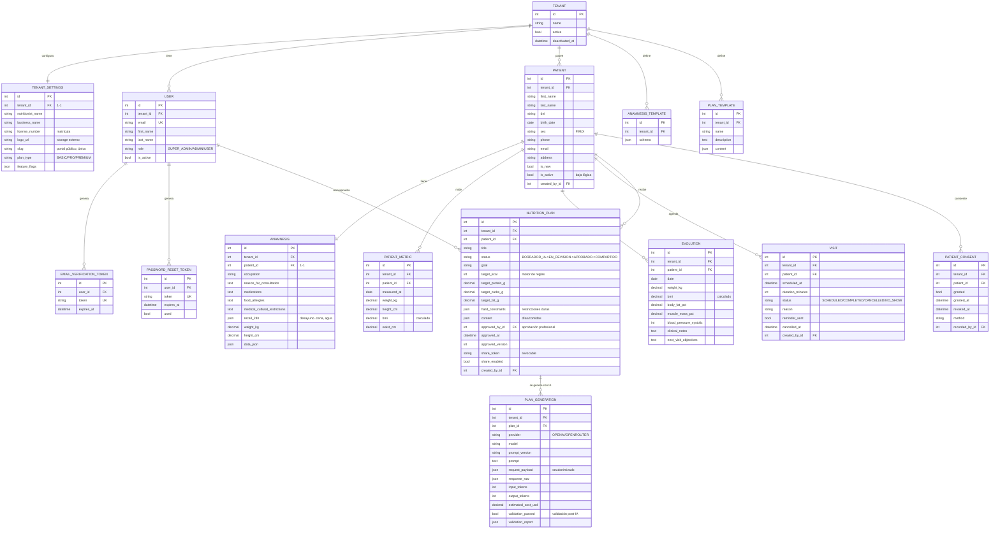

# Nutrilius — Estructura de datos (DER del prototipo)

> Modelo de datos del prototipo para la Entrega 2. Derivado del código real
> (`backend/apps/*/models.py`). Incluye las entidades **implementadas** y las de la
> **Épica 6 (Planes + IA supervisada)**, cuyo modelo ya está diseñado (app `apps.plans`)
> aunque su lógica se implementa en el Sprint 4.
>
> Convenciones: toda entidad de negocio hereda de `TenantOwnedModel` → lleva `tenant_id`
> y se filtra por tenant (aislamiento multi-tenant, RNF-01). `created_at`/`updated_at`
> son transversales (omitidos en el diagrama por claridad).

## Justificación del diagrama elegido

Se presenta un **Diagrama de Entidad-Relación (DER)** porque el prototipo usa una **base
de datos relacional (PostgreSQL)**. El DER es el diagrama adecuado para modelar datos
relacionales: representa entidades, atributos y las relaciones entre ellas mediante
claves primarias (PK) y foráneas (FK), de forma normalizada. No se usan diagramas de
clases (propios de un modelo orientado a objetos puro) ni de base NoSQL, ya que el
almacenamiento es relacional. El **diccionario de datos** que acompaña al DER está en
`DICCIONARIO_DATOS.md` (obligatorio porque los nombres técnicos están en inglés).

## Diagrama entidad-relación

## Notas de diseño relevantes para la tesis

1. **Aislamiento (RNF-01):** `tenant_id` en toda entidad de negocio; el `TenantManager`
   filtra por el tenant del request. Es la restricción de seguridad transversal.
2. **Datos de salud (RNF-02/03):** `Anamnesis`, `PatientMetric`, `Evolution` son datos
   sensibles (Ley 25.326) → cifrado en reposo y auditoría de acceso (Sprint 6).
3. **Máquina de estados del plan (RF-IA-06):** `NutritionPlan.status` gobierna la
   visibilidad; el paciente solo ve `APROBADO`/`COMPARTIDO`. La aprobación queda firmada
   (`approved_by`, `approved_at`, `approved_version`).
4. **Trazabilidad y seudonimización de IA (RF-IA-05/07):** `PlanGeneration.request_payload`
   guarda lo que se envió a la IA, **sin datos identificatorios**; se registra proveedor,
   modelo, versión, tokens y costo.
5. **Consentimiento (RF-IA-10):** `PatientConsent` exige consentimiento activo del paciente
   antes de generar con IA.
6. **Fuera del alcance:** `Payment` e `Insurance` (billing) no forman parte del prototipo
   de la tesis y no se modelan.

## Entidades por estado de implementación

| Entidad | Estado | App |
|---|---|---|
| Tenant, User, Patient, Anamnesis(+Template), PatientMetric, Evolution, Visit, AuditEvent, tokens | ✅ Implementadas | tenants, identity, clinical, scheduling, audit |
| **TenantSettings** | 🟡 Modelo diseñado (Sprint 4) | tenants |
| **NutritionPlan, PlanTemplate, PlanGeneration, PatientConsent** | 🟡 Modelo diseñado (Sprint 4) | plans |
