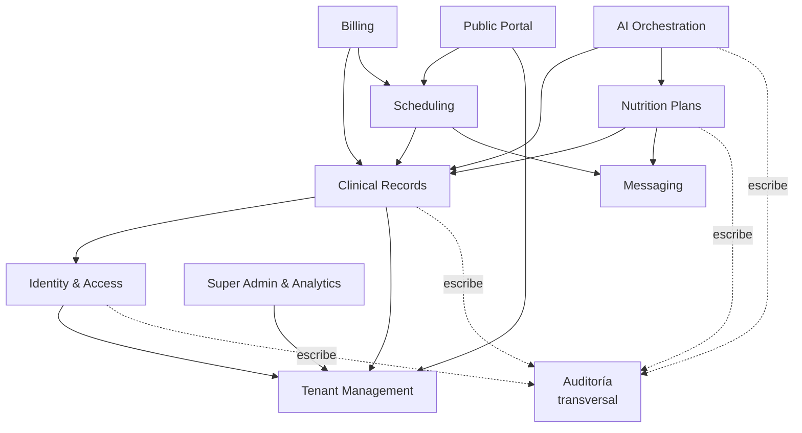

# Módulos — Nutrilius

Explicación detallada de cada módulo (bounded context) del sistema: qué hace, qué
entidades maneja, de qué otros módulos depende y qué reglas lo gobiernan. Pensado
como referencia para diseñar, cambiar y corregir el sistema (incluida asistencia de
IA sobre el código).

Stack de destino: `Python + Django + DRF` (una **Django app por módulo**).
Ver `REQUERIMIENTOS.md` (RF/RNF), `CASOS_DE_USO_Y_FLUJOS.md` (flujos) e
`INFRAESTRUCTURA.md` (deploy).

> **Convención de testing:** cada módulo incluye su suite de tests (`pytest` +
> `pytest-django`) y se construye **con tests como parte de la misma fase**, no
> después. Cada módulo detalla abajo, en **Tests**, qué cubre. Los tests viven en
> `backend/apps/<modulo>/tests/`. Estado ✅ = implementado y verde; ⏳ = planificado
> para la fase del módulo.

---

## Mapa de dependencias

**Reglas transversales (aplican a todos los módulos):**
- **Aislamiento por tenant:** toda entidad de negocio lleva `tenant_id`; todo query se filtra por el tenant del usuario. Ningún módulo accede a datos de otro tenant (RNF-01).
- **Auditoría:** los eventos sensibles se registran en Auditoría (RNF-03, RNF-04).
- **Datos de salud:** anamnesis, métricas y evoluciones son datos sensibles; cifrado en reposo y acceso auditado (RNF-02).

---

## 1. Identity & Access
**Propósito:** autenticación, autorización y ciclo de vida de usuarios.
**Entidades:** `User` (email, password hash, rol, activo, verificación de email, tokens de reset), tokens JWT/refresh.
**Responsabilidades:** registro de tenant+admin, login, refresh, confirmación de email, forgot/reset, gestión de usuarios internos, control de roles `SUPER_ADMIN`/`ADMIN`/`USER`.
**Depende de:** Tenant Management (un usuario pertenece a un tenant, salvo `SUPER_ADMIN`).
**Usado por:** todos los módulos (identidad del actor y rol).
**Reglas clave:** sin email confirmado no hay login; tokens firmados con expiración corta (RNF-05); hashing con el hasher de Django; `simplejwt` para JWT+refresh.
**Requerimientos:** RF-01..06.
**Login con Google:** además del email/contraseña, `POST /api/auth/google` (login: verifica el ID token y emite JWT; si no existe el usuario, responde `needs_registration`) y `POST /api/auth/google/register` (registro de consultorio con Google + formulario para el nombre del consultorio; email ya verificado por Google, sin contraseña). Registro abierto a cualquiera.
**Tests ✅** (`apps/identity/tests/`): registro crea tenant+admin sin verificar y rechaza email duplicado; login bloqueado sin confirmar; confirm→login OK; token de verificación de un solo uso e inválido; `/me` requiere auth; reset de contraseña completo y anti-enumeración; alta/listado/toggle de usuarios internos con permiso por rol, aislamiento entre tenants y prohibición de auto-desactivarse; registro de eventos de auditoría; **login/registro con Google** (usuario existente, nuevo→needs_registration, alta de consultorio, email duplicado, token inválido) con la verificación mockeada.

## 2. Tenant Management
**Propósito:** representar cada consultorio como unidad aislada y su configuración comercial.
**Entidades:** `Tenant` (nombre, activo, fechas de alta/baja), `TenantSettings` (nombre del nutricionista, nombre comercial, matrícula, logo, `slug` público, plan/feature flags).
**Responsabilidades:** alta/baja de tenant, configuración del consultorio, logo (a storage externo), slug público único, habilitación de módulos por plan/feature flags.
**Depende de:** — (es la raíz del aislamiento).
**Usado por:** todos (proveen `tenant_id`); Public Portal (resuelve por `slug`); Super Admin (administra tenants).
**Reglas clave:** feature flags por tenant en vez de acoplar lógica a un enum de plan (RNF-15); `slug` único; logo en S3-compatible, no en base (RNF-11).
**Requerimientos:** RF-28..30.
**Tests:** ✅ creación de `Tenant` y context-var/middleware de tenancy (`apps/common/tests/test_tenancy.py`); ⏳ (Fase 3) `slug` único, feature flags que habilitan/deshabilitan módulos, subida de logo a storage.

## 3. Clinical Records
**Propósito:** núcleo clínico: pacientes y su historia.
**Entidades:** `Patient` (datos personales, `is_new`, baja lógica), `Anamnesis` (**una por paciente, upsert**: generales, antecedentes/hábitos tóxicos, alimentación, recordatorio 24 h, actividad física, antropometría, comentarios + `data_json`), `AnamnesisTemplate` (JSON por tenant), `PatientMetric` (peso, talla, IMC, cintura, cuello, fecha), `Evolution` (**control fechado con antropometría/composición + IMC calculado + notas/valoración/objetivos**).
**Responsabilidades:** CRUD de pacientes con búsqueda/paginado; carga y edición de anamnesis; plantilla de anamnesis configurable; métricas antropométricas en el tiempo; evoluciones.
**Depende de:** Identity (autor), Tenant (aislamiento).
**Usado por:** Scheduling, Billing, Nutrition Plans, **AI Orchestration** (la anamnesis y las métricas son los inputs del motor de reglas).
**Reglas clave:** datos sensibles de salud (cifrado + auditoría de acceso, RNF-02/03); la anamnesis define los inputs de IA (edad, sexo, peso, talla, patologías, restricciones, alergias, hábitos, objetivo).
**Requerimientos:** RF-07..14.
**Tests ✅** (`apps/clinical/tests/`): CRUD de paciente con aislamiento por tenant (no ve ni accede a pacientes de otro → 404), baja lógica/reactivación, búsqueda, y auditoría de alta (`PATIENT_CREATED`) y de **acceso de lectura** (`CLINICAL_READ`); anamnesis solo acepta pacientes del propio tenant; IMC calculado si falta; evoluciones; plantilla get/put/reset; **filtrado real del `TenantManager`** por contexto.

## 4. Scheduling
**Propósito:** agenda y turnos del consultorio.
**Entidades:** `Visit` (paciente, fecha-hora, duración, estado `SCHEDULED`/`COMPLETED`/`CANCELLED`/`NO_SHOW`, motivo, notas, `reminder_sent`, `cancelled_at`; acciones cancelar/completar).
**Responsabilidades:** crear/editar/cancelar turnos; vista de agenda; marcar recordatorio enviado.
**Depende de:** Clinical (paciente), Identity, Tenant.
**Usado por:** Billing (un pago puede asociarse a una visita); Public Portal (booking crea turnos); Messaging (recordatorios/confirmaciones).
**Reglas clave:** estados de turno; recordatorios como tarea async (Celery).
**Requerimientos:** RF-15..17.
**Tests ✅** (`apps/scheduling/tests/`): crear visita con defaults (duración 45, estado `SCHEDULED`); rechazo de paciente de otro tenant; listado scoped por tenant y filtro por `status`. ⏳ transiciones de estado y disparo real de recordatorio (cuando se integre Messaging/Celery).

## 5. Billing
**Propósito:** cobros y obras sociales.
**Entidades:** `Payment` (método, monto, estado `PAID`/`PENDING`, `paid_at`, `due_at`, visita/insurance asociados), `Insurance` (obra social por tenant).
**Responsabilidades:** registrar pagos; catálogo de obras sociales; estados y vencimientos.
**Depende de:** Clinical (paciente), Scheduling (visita), Tenant.
**Usado por:** Dashboard/Analytics (cobros del mes).
**Reglas clave:** estados de pago; montos con formato `es-AR` en el front.
**Requerimientos:** RF-18..19.
**Tests ⏳** (Fase 3): registrar pago con estado/vencimiento; asociación a visita e insurance; CRUD de obras sociales; aislamiento por tenant.

## 6. Nutrition Plans
**Propósito:** el plan alimentario del paciente: edición, plantillas, PDF y compartición.
**Entidades:** `Plan` (paciente, contenido, **estado** de la máquina de aprobación, `share_token`, `share_enabled`, versión), `PlanTemplate` (estructura reutilizable por tenant).
**Responsabilidades:** obtener/editar/guardar plan; plantillas; export a PDF con branding; compartir por link/token revocable; acceso público al PDF por token.
**Depende de:** Clinical (paciente/anamnesis), **AI Orchestration** (genera el borrador), Messaging (envío del plan), Tenant (branding).
**Usado por:** Public Portal (acceso público al PDF).
**Reglas clave:** **el paciente solo ve un plan `APROBADO`/`COMPARTIDO`** (gate forzado en backend, RF-IA-06); token de compartición revocable (RNF-05); PDF con logo/matrícula del tenant.
**Requerimientos:** RF-20..25.
**Tests ⏳** (Fase 4): máquina de estados (transiciones válidas e inválidas); **el acceso público solo sirve planes `APROBADO`/`COMPARTIDO`** (un `BORRADOR_IA` nunca es visible); token de compartición revocable deja de servir el PDF; branding del tenant en el PDF; aislamiento por tenant.

## 7. AI Orchestration ⭐
**Propósito:** asistencia de IA **supervisada** para el borrador del plan. Es el diferencial del proyecto y el núcleo de la devolución del asesor.
**Entidades:** `PlanGeneration` (prompt, proveedor, modelo, versión, timestamp, usuario, costo estimado, resultado), reglas nutricionales (parámetros de cálculo).
**Responsabilidades (3 capas, en orden):**
1. **Motor de reglas (previo):** requerimiento energético (p. ej. Mifflin-St Jeor) + distribución de macros + restricciones duras (patologías, alergias, intolerancias).
2. **IA (acotada):** el LLM propone alimentos/variedad **dentro** de esos límites; se envía un perfil **seudonimizado** (sin nombre/DNI/contacto).
3. **Validación (posterior):** recalcula calorías/macros y verifica restricciones; si no cumple, regenera o marca para revisión.
**Depende de:** Clinical (anamnesis + métricas), Nutrition Plans (crea el plan en estado `BORRADOR_IA`).
**Usado por:** Nutrition Plans (recibe el borrador).
**Reglas clave (no negociables):** la IA **nunca decide sola**; **seudonimización** obligatoria (RF-IA-05); **aprobación profesional** obligatoria antes de la entrega (RF-IA-06); proveedor/modelo **configurable** con fallback, sin hardcodear (RF-IA-09); trazabilidad completa por generación (RF-IA-07); consentimiento del paciente (RF-IA-10). *La versión previa violaba casi todas: es el anti-patrón a no repetir.*
**Requerimientos:** RF-IA-01..10.
**Tests ⏳** (Fase 4, críticos): el motor de reglas calcula GET/macros esperados para casos conocidos; **el payload a la IA no contiene identificadores** (test que falla si aparece nombre/DNI/contacto — DS-03); el validador rechaza un plan que viola una restricción dura y fuerza regeneración; no se puede generar sin anamnesis ni sin consentimiento; cada generación deja traza (prompt/modelo/versión/costo); el proveedor es configurable (mock del LLM, sin llamadas reales en test).

## 8. Messaging
**Propósito:** comunicación saliente (email) y notificaciones.
**Entidades:** plantillas/registros de envío (según se modele).
**Responsabilidades:** confirmación de email, reset, confirmación/recordatorio de turnos, envío del plan; todo vía Celery.
**Depende de:** — (servicio transversal); consumido por Identity, Scheduling, Nutrition Plans, Public Portal.
**Reglas clave:** envíos como tareas async con reintentos (RNF-10); SMTP configurable.
**Tests:** ✅ (parcial) envío de email de verificación/reset con backend en memoria (`locmem`) verificado en los tests de Identity; ⏳ reintentos y plantillas cuando se centralice la mensajería.

## 9. Public Portal
**Propósito:** superficie pública sin login: reservas y acceso a planes compartidos.
**Entidades:** reutiliza `TenantSettings.slug`, `Visit`, `Patient`, `Plan.share_token`.
**Responsabilidades:** info y disponibilidad por `slug`; reservar turno sin login (crea paciente `is_new` si no existe); acceso al PDF del plan por token.
**Depende de:** Tenant (resuelve slug), Scheduling (crea turno), Nutrition Plans (PDF por token), Messaging (confirmación).
**Reglas clave:** rate limiting en endpoints públicos (RNF-06); no exponer datos de otros pacientes; tokens revocables.
**Requerimientos:** RF-26..27, RF-25.
**Tests ⏳** (Fase 5): resolución por `slug`; reserva sin login crea paciente `is_new`; el endpoint público no filtra datos de otros pacientes/tenants; rate limiting; token de plan revocado no sirve el PDF.

## 10. Super Admin & Analytics
**Propósito:** administración transversal de la plataforma.
**Entidades:** vistas agregadas sobre `Tenant`, uso, consumo de IA.
**Responsabilidades:** listar tenants, analytics de uso, activar/desactivar tenant, cambiar plan comercial, resetear contraseña del admin de un tenant.
**Depende de:** Tenant Management, y lectura agregada de otros módulos.
**Reglas clave:** único rol que opera fuera de un tenant; sus acciones se auditan.
**Requerimientos:** RF-31..33.
**Tests ⏳** (Fase 3): solo `SUPER_ADMIN` accede a la consola (un ADMIN recibe 403); activar/desactivar tenant; cambio de plan; sus acciones quedan auditadas.

## 11. Auditoría (transversal)
**Propósito:** trazabilidad de eventos sensibles y de acceso a datos de salud.
**Entidades:** `AuditEvent` (actor, tenant, acción, entidad, timestamp, metadata).
**Responsabilidades:** registrar login/reset/confirmación, altas/bajas, **acceso (lectura) a datos clínicos**, generación de planes IA, exportación/compartición de PDF, cambios de configuración, acciones de super admin.
**Usado por:** todos los módulos.
**Reglas clave:** el acceso de lectura a historia clínica también se audita (RNF-03); inmutable.
**Requerimientos:** RNF-03, RNF-04.
**Tests:** ✅ (parcial) el helper `log_event` registra acciones y se verifica en los tests de Identity (`TENANT_REGISTERED`, `EMAIL_CONFIRMED`, `LOGIN`); ⏳ auditoría de acceso de lectura a datos clínicos (Fase 2) y de generación de planes (Fase 4).
